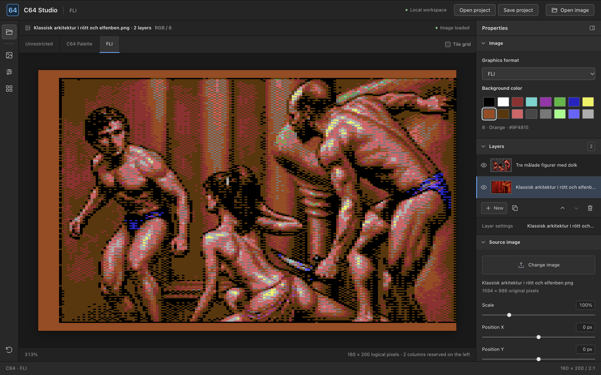
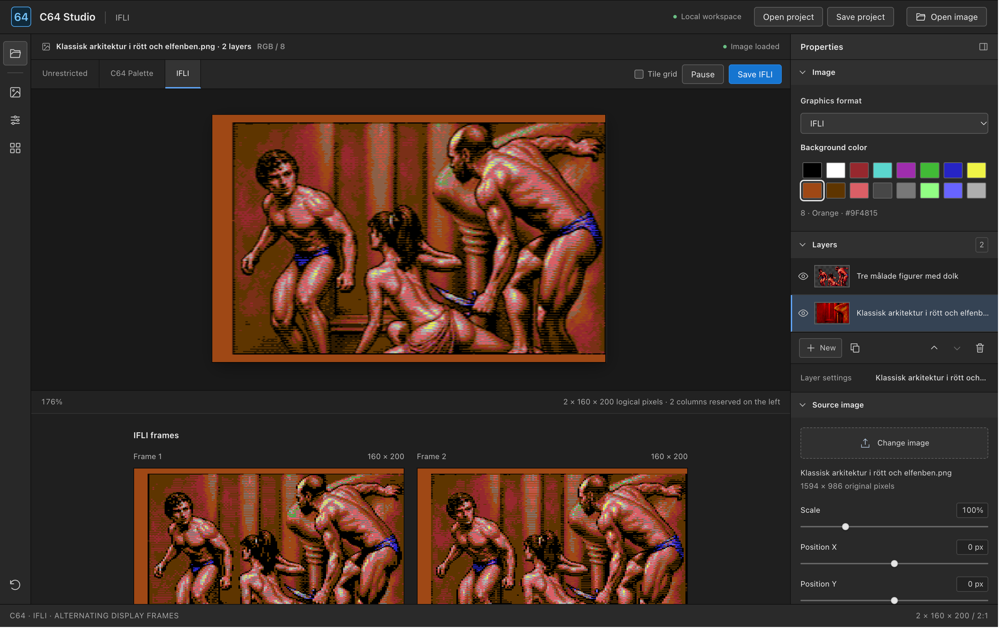
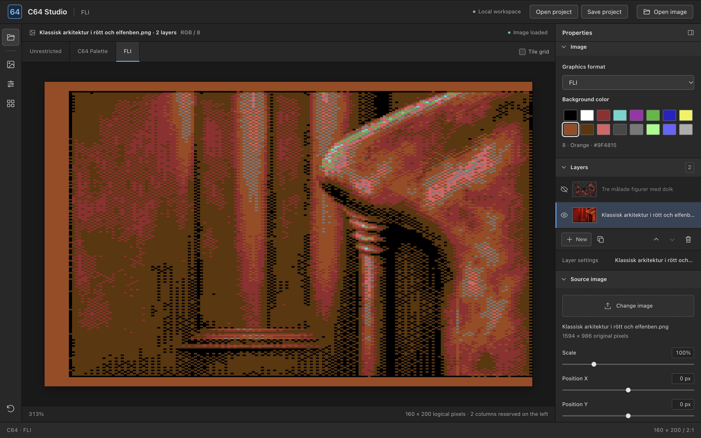
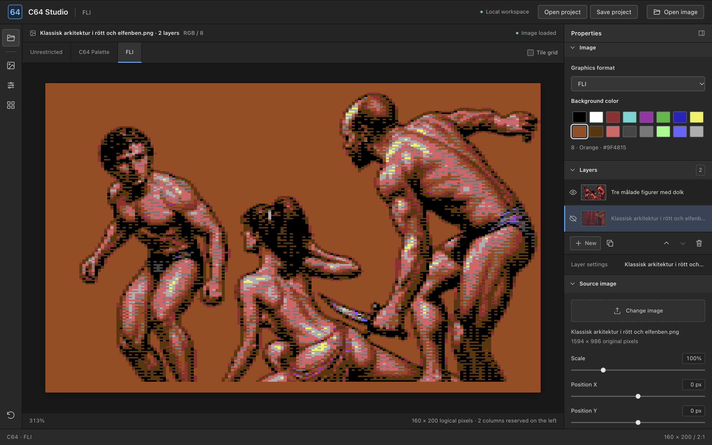

# C64 GFX Convert

[Open the converter](https://rogeralsing.github.io/c64gfxconvert/)

A browser-based Commodore 64 image converter with FLI, IFLI, MCI, AFLI, HIRES,
Multicolor Bitmap, Charset, standalone Sprites and NUFLI modes, optional virtual colors, sprite
overlays, and native exports. Image processing stays in your browser.



## Sampled music experiments

The [native SID mixer](experiments/sid-voice-sampler/README.md) combines a
software triangle bass and reusable drum samples through one SID voice, leaving
two voices for ordinary synthesis. The current Hyperbased proof includes a
runnable PRG, actual VICE audio and measured CPU deadlines.

## Run locally

Open `index.html` in a modern browser. No build step or server is required.

Choose **Tiles** in the Layers toolbar to add a tile marker layer. Click an
8 × 8 character tile to switch its marker on or off; drag to paint that same
state across more tiles. **Layer settings → Tile markers → Overlay color**
sets the translucent overlay color. Markers stay fixed on the screen, have no
image adjustments or transforms, and never enter converted graphics or native
exports. Projects preserve the markers, color, and layer visibility.

Choose **Colodore (PAL)**, **Pepto (PAL)**, or **PEPTOette_a** in **Image → C64 palette**, below
the graphics format. Colodore remains the default. Switching updates conversion,
previews, color swatches, and virtual colors across all layers. Projects save
the chosen palette; older projects use Colodore. See [palette sources](palettes/README.md).

## Source adjustments

**Levels & curves** provides an editable tone curve over an RGB histogram.
Click to add points, drag them to shape the curve, and use **Input**/**Output**
for exact values. Delete or double-click an interior point to remove it.
The focused curve also supports arrow keys, Page Up/Page Down to select points,
and Insert to add a point. **Reset curve** clears only the custom curve;
**Reset** also restores the black point, midtones, and white point under
**Input levels**. The custom curve follows those input-level adjustments.

**Interlace** lifts selected lines toward white at positive strength and darkens
them toward black at negative strength. **Line spacing** sets the distance
between lines, from 1–32 steps. Choose **Horizontal —**, **Rising diagonal /**,
or **Falling diagonal \\**. Each line remains one 2×1 display pixel thick,
including in hires modes. At spacing 2, both diagonal directions produce the
same checker pattern; spacing 3 or more makes their directions distinct.

Curve points, interlace spacing, and direction belong to each layer and are
saved in projects. Older projects retain a neutral curve and the original
horizontal interlace pattern at spacing 2.

## Graphics formats

| Format | Logical pixels | Color allocation |
| --- | --- | --- |
| **FLI** | 160 × 200, double-width pixels | One shared background, one color per 4 × 8 tile, and two additional colors per scanline within each tile. |
| **IFLI** | Two 160 × 200 frames, double-width pixels | Alternates two FLI frames one hires pixel apart. Both frames share the background and tile color; scanline colors may differ. |
| **MCI** | Two 160 × 200 frames, double-width pixels | Alternates two standard multicolor frames one hires pixel apart. Both frames share the background and one tile color; each frame has two additional colors fixed throughout each 4 × 8 tile. The full image width is available. |
| **AFLI** | 320 × 200, square pixels | Two freely chosen colors per 8 × 1 scanline strip, with no shared background color. |
| **HIRES** | 320 × 200, square pixels | Two freely chosen colors per 8 × 8 tile, with no shared background color. |
| **HIRES · 2 colors** | 320 × 200, square pixels | One user-selected shadow/highlight pair for the entire image. Source brightness drives the pattern; no automatic palette matching. |
| **Multicolor Bitmap** | 160 × 200, double-width pixels | Three colors per 4 × 8 tile, plus one background color shared by the whole image. |
| **Charset · Hires + Multicolor** | 40 × 25 cells covering 320 × 200 pixels | Up to 256 unique patterns. Shared background and two shared multicolors; each cell chooses hires or multicolor with an individual foreground from colors 0–7. |
| **Multicolor Sprites** | 12 × 21 double-width pixels per sprite | One shared background, two shared multicolors, and one individual color per sprite. Configurable grid, up to eight sprites. |
| **Multicolor + Hires Sprites** | 24 × 21 display pixels per cell | A multicolor sprite beneath a hires sprite with its own color. Up to four cells, using eight hardware sprites. |
| **NUFLI** | 320 × 200, square pixels | A hires bitmap with 8 × 2 color cells and a sprite underlay for additional color choices. |

Virtual colors are a separate layer setting: **Off**, **Lines**, or **Checkers**.
New documents start with **PEPTOette_a**, **Talent**, and **Checkers**. New image
layers enable black and white solid entries and all mixed colors; the other
14 solid entries start disabled. Opening a project restores its saved settings.
Pairs use actual palette lightness to put the darker component on even parity
and the lighter component on odd parity. Checkers use `(x + y) & 1` throughout
the image; Lines use row parity. Pair IDs and catalogue ordering do not change
the pattern phase. Colors with equal C64 brightness use ascending color index
as the tie-break, so blue (6) precedes brown (9).

**Image → Virtual color mode** selects the virtual palette for the whole image:
**Computed** keeps the existing generated color pairs, while **Talent** builds
black-to-white scales from neighboring tones observed in Talent's artwork.
Every step in a scale was observed within the same source image. The palette
reconstructs paths through those contacts; contacts can also mark object
boundaries, so they do not prove deliberate gradients. The palette
shows these scales as columns, black at the top and white at the bottom, with
different numbers of tones. Scroll horizontally to inspect every scale.
Each mixed-color swatch shows its two active C64 component colors underneath.
A separate **Standard colors** column lists all 16 solid colors in C64 index
order. These buttons toggle solid entries in the virtual palette;
disabling a solid does not disable its separately enabled mixtures.
All 92 Talent colors are available: the 76 retained mixed pairs and all 16
solid C64 colors. Tones outside the example scales appear in an additional column.
Talent mixes pairs in linear light using the selected C64 palette. It groups
colors by their actual Oklab lightness, with at most three percentage points
between the darkest and lightest tone in a level. The level count comes from
the palette; PEPTOette_a currently has 20 Talent levels. Computed keeps its
existing 17 rows. Both modes call the same mapper: select the brightness level,
using the Dither setting to interpolate neighboring levels, then match chroma
within that level. Hue cannot select a different brightness level.
Talent scans two source rows at a time: 0–1, 2–3, and so on. Each vertical pair
with equal nonzero alpha and an Oklab color distance of at most 0.03 is treated
as one surface sample. Its linear-light RGB average selects one virtual color,
which is written identically to both pixels. Brightness dithering runs on this
pair grid, so it cannot split a matched pair into different virtual colors.
Different colors, transparency edges, and an unpaired final row map each source
pixel separately through the same enabled virtual palette, without averaging
the pixels or adding brightness dithering. Both paths can select solid or mixed
colors. The comparison uses source pixels after the layer's adjustments.
Graphs and observed scale paths do not restrict selection. Lightness caps and
palette exclusions apply to both surface samples and individual pixels. Disabling
a solid color removes that entry from both paths; separately enabled mixtures
containing that color remain available. Images can use a selection containing
only mixed colors, including where source pixels differ.
The C64 Palette view receives exact selected virtual RGB values: shared across
similar pairs or chosen individually for differing pixels. Lines or Checkers
resolve the selected component pairs afterward.
Choose **PEPTOette_a** to reproduce the sampled palette's RGB values. The mode
applies to every layer with virtual colors enabled and is saved in projects.
Older projects default to Computed. Each layer retains its own pattern,
brightness limits, and color exclusions. Talent's lightness limits run from
0–100%; Computed retains levels 0–16. Layers preserve both ranges separately.
Legacy Talent projects migrate their row limits to the measured lightness
range of the tones those rows admitted. Existing color exclusions are preserved.
A mode switch keeps at least one
available color enabled within each layer's selected brightness range.

Select **Charset · Hires + Multicolor** to convert a full screen into one C64
character set. Choose a background and two shared multicolors from all 16 colors.
The converter scores each cell in hires and multicolor with every legal
foreground color. It compares rendered colors in Oklab, so close shades can
collapse to one foreground when that preserves more detail. Pattern reuse also
reconsiders the cell's foreground and resolution, rather than comparing glyph
bytes alone.

**Tile similarity** controls how much difference is allowed when merging nearby
patterns, even when the screen already fits within 256 glyphs. The default is
35%. At 0%, only identical patterns share a slot unless the hardware limit
forces approximation. Higher values allow more shape and shade differences.
Perceptual error limits protect contrast and dithering at moderate settings.
If the screen still needs more than 256 patterns, the converter retains
representative patterns by rendered similarity and refits the remaining cells.

The result includes both the charset and its 40 × 25 placement map. Merged cells
reference the same glyph index while retaining their own color and mode. The
preview always shows the actual exported result. The summary reports pattern
reduction, approximated cells, and how many cells use each mode; the generated
charset appears below.

In this mixed character mode, Color RAM bit 3 selects the cell's resolution:

| Color RAM | Cell mode | Foreground |
| --- | --- | --- |
| 0–7 | Hires, 8 × 8 pixels | The selected color 0–7 |
| 8–15 | Multicolor, 4 × 8 double-width pixels | The value AND 7, still color 0–7 |

For example, Color RAM value 9 means multicolor with a white foreground, not
brown. The background and both shared multicolors can still use colors 8–15.
This restriction applies to mixed multicolor character mode; pure hires text
mode can use all 16 foreground colors. All 256 glyphs are available in either
cell mode. Color RAM belongs to each screen position, not to a glyph definition.
See the [Commodore Programmer's Reference](https://www.commodore.ca/manuals/c64_programmers_reference/c64-programmers_reference_guide-03-programming_graphics.pdf), pages 115–117.

**Save charset** downloads a ZIP with a 2,048-byte `charset.bin`, 1,000-byte
`screen.bin`, 1,000-byte `color-ram.bin`, and a manifest containing shared colors
and VIC mode settings. It contains raw data without load addresses or a player.
Projects preserve shared colors, tile similarity, source layers, and conversion
settings. `screen.bin` places the glyphs in row-major order, and `color-ram.bin`
stores each position's foreground and hires/multicolor flag.
Source adjustments and per-layer dithering remain available; virtual colors and
line-end dithering do not apply to charset conversion.

For standalone sprites, choose **Multicolor Sprites** or **Multicolor + Hires
Sprites**. Set **Sprite grid · columns × rows** to a layout such as 1 × 1,
1 × 8, or 2 × 2. Every cell covers 24 × 21 display pixels. The overlay mode
uses two hardware sprites per cell, so 2 × 2 uses four multicolor sprites and
four hires overlays. Switching to overlays reduces an oversized grid to 2 × 2.

Choose the background and two shared multicolors, then use **Edit sprite colors**
to choose each cell's multicolor sprite color and optional hires overlay color.
The restricted preview fits only these colors. Source framing, adjustments,
layers, and per-layer dithering remain available. Virtual colors and line-end
dithering do not apply to standalone sprites. Overlay mode also shows the
multicolor and hires layers separately.

**Save sprites** downloads a ZIP containing `sprites.bin` and `manifest.json`.
The binary contains one native 64-byte frame per hardware sprite: 63 image
bytes and one zero padding byte. The manifest records colors, relative grid
positions, hardware slots, and VIC enable/multicolor masks. Hires overlays occupy
lower-numbered slots so they appear in front. The ZIP does not include a player.
Saved projects preserve the sprite grid and every chosen color.

## Border sprites

**Image → Border sprites** extends bitmap and charset pictures into the PAL
borders. Enable **Vertical borders · top / bottom**, **Side borders · left / right**,
or both. These settings belong to the whole image and are saved in projects.
Standalone sprite, sprite overlay, NUFLI and PAFLI formats keep the settings but
disable the borders.

Each group has its own **Hires / Multicolor** mode and sprite color. Multicolor
sprites also use two shared colors, chosen below the groups. Transparent sprite
pixels show the existing image **Background color**, shared with the bitmap.
All color choices follow the selected C64 palette.

Border sprites use each layer's **Talent / Computed**, virtual-color pattern,
brightness limits, color exclusions and dither settings. Available virtual
colors are limited to mixtures of the group's background, sprite color and
shared multicolors. Patterns resolve at the sprite's native pixel size before
expansion, so multicolor and expanded sprites retain their mixtures too.
The C64 Palette preview shows the selected virtual RGB values; the restricted
preview and exported sprite bytes show the resolved native colors. **Off**
retains the solid-color fit.

The source fits the extended picture: 320 × 272 with vertical borders,
368 × 200 with side borders, or 368 × 272 with both. The bitmap stays 320 × 200
inside it. Top and bottom sprites are horizontally expanded, giving two display
pixels per hires bit or four per multicolor pixel; side sprites use one or two.
Each top/bottom border uses two rows of eight normal-height sprites, preserving
single-line vertical detail. Their 42-line span is clipped to the 35 visible
top rows and 37 bottom rows. Side sprites also keep their normal 21-pixel height
and are reused down the raster. A spare pair handles the final eleven visible
side rows so every slot is free for the bottom border.
The restricted preview shows the fitted sprite colors and resolution.

MCI and IFLI also alternate two independently fitted sprite fields. The second
field shifts every sprite one hires pixel right, synchronized with the bitmap.
The preview preserves sprite priority at the left edge and the bitmap's
one-pixel spill into the right border.

**Save border sprites** downloads a ZIP with native 64-byte frames in
`sprites.bin` and a `manifest.json` containing colors, PAL positions, expansion,
and multiplexing metadata. This is a data export without a raster player. Save
the central bitmap separately with its normal format button.
Both border groups use 52 native frames (3,328 bytes) per field. MCI and IFLI
exports include both fields: 104 frames (6,656 bytes), with their phase and
one-pixel offset recorded in the manifest.

For two-color artwork, select **Hires · 2 colors**, then choose **Shadow color**
and **Highlight color** from the normal C64 palette. Adjust **Brightness**,
**Contrast**, **Levels**, and **Dither** to shape the result. Dither at 0% uses a
hard threshold; 100% uses a 4 × 4 ordered pattern. Palette choices do not change
the pattern, so swapping the colors also works as an inversion. Transparent
layer edges use ordered coverage to keep the final image within the selected
pair. Both colors are preserved in saved projects.

**Save Hires** downloads an Art Studio `.art` image: 320 × 200 pixels with the
selected colors, stored as a native C64 hires bitmap. The 9,009-byte file contains
a `$2000` load address, bitmap, screen colors, border color, and padding. Export
always uses the converted image, even while viewing the unrestricted source.

**Save Multicolor** downloads a Koala Painter `.koa` image in **Multicolor Bitmap**
mode. The 10,003-byte file contains a `$6000` load address, bitmap, screen colors,
color RAM, and the selected background color. Export uses the fitted composition
from all visible layers, regardless of the selected preview tab.

**Save FLI** downloads a native `.fli` image in **FLI** mode. The 17,666-byte
uncompressed FLI Graph file loads at `$3B00` and preserves the fitted bitmap,
eight screen-color banks, color RAM, and selected background color. Export uses
the fitted composition from all visible layers, regardless of the preview tab.
The file contains image data; it does not include a runnable C64 player.

**Save MCI** downloads a native True Paint `.mci` image containing both fitted
bitmaps, their separate screen colors, shared color RAM, and background color.
The 19,434-byte file loads at `$9C00`. Like other exports, it uses the fitted
composition regardless of the selected preview tab. MCI uses standard multicolor
cells without FLI's per-scanline color changes or reserved left columns.

The IFLI and MCI previews alternate the two frames and show them individually below
the simulation:



## Layers

Build one image from several source images, with separate conversion settings
for each layer. For example, put scenery on the bottom layer and figures with
a transparent background on a layer above it. Transparent pixels reveal the
layers below. The opening screenshot shows both layers combined; these views
show each layer on its own:

| Background layer only | Foreground layer only |
| --- | --- |
|  |  |

**Image** settings apply to the whole composition: graphics format, background
color where the format supports it, and hardware sprite colors in sprite
modes. All layers use the same graphics format.

Select a layer in **Layers** to edit its source image, position, scale,
brightness, contrast, levels, hue, saturation, noise, interlace, dithering,
virtual colors, palette limits, excluded colors, and sprite matching. Changes
apply only to the selected layer, so you can tune figures and scenery
independently.

- Click **New**, then **Choose image**, to add a source image to a new layer.
- Layers paint from bottom to top. Use the arrows to change their order.
- Click an eye to hide or show a layer without deleting it.
- Use **Duplicate** to start from an existing layer, or **Delete** to remove one.
- Double-click a selected layer name, or press **F2**, to rename it.
- Drag the preview to move the selected layer, or use **Scale**, **Position X**,
  and **Position Y** for precise placement.

Select an image layer and click the **Crop selected layer** tool, or **Crop
source…** under Source image. The crop editor shows the original image. Drag
rectangle corners to resize the mask, or choose **Polygon** to move each point
independently. Click an edge to add a point; select a point and press **Delete**
to remove it. Arrow keys move the selected point one source pixel, or ten with
**Shift**. **Insert** adds a point; **Page Up/Down** selects another point.
Click **Apply crop** to keep the visible area, or **Cancel** to discard edits.
**Reset crop**, then **Apply crop**, restores the full image. Crops preserve the
original source and its placement, reveal lower layers outside the mask, and remain editable in
saved projects. Duplicated layers have independent crop masks.

Visible layers combine into one image before the final C64 tile restrictions
are applied. The preview and native export use that same fitted result.

## Projects

Use **Save project** to download a JSON file containing all layers, their source
images, and their settings. **Open project** restores that file, including layer
order, visibility, the active layer, shared graphics settings, and preview options.
Images are embedded in the JSON, so the original files are not needed to reopen
it. Larger source images produce larger project files. Projects stay local.

[Open the DutchBreezeRemake demo](https://rogeralsing.github.io/c64gfxconvert/?project=dutchbreeze)
with all layers and settings loaded. The `?project=dutchbreeze` query parameter
opens the bundled demo automatically. Without it, the converter starts empty.
You can also download [the project JSON](examples/DutchBreezeRemake.json) and
choose **Open project**.

## Tests

```sh
node --test tests/*.test.cjs
```

## GitHub Pages

GitHub Pages publishes the repository root from `main`. Pushes to `main`
automatically update the site. The `.nojekyll` file serves the static app
without Jekyll processing.
