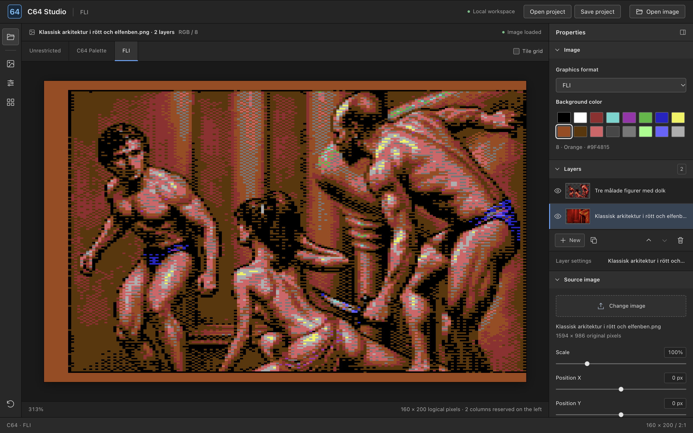
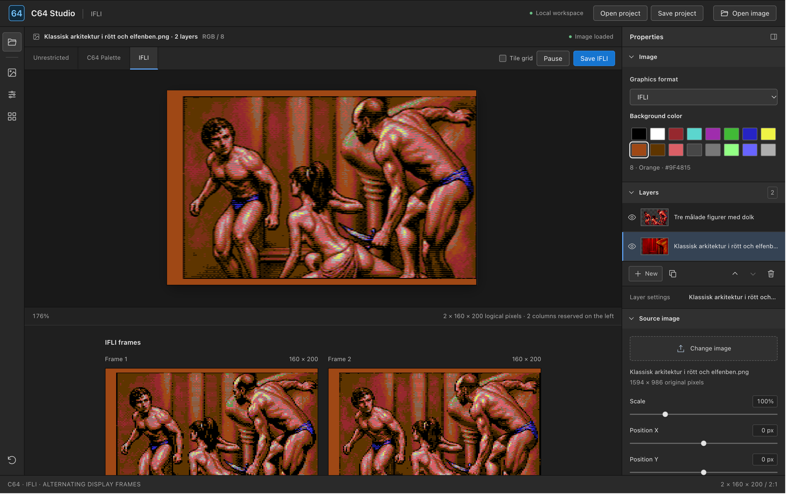
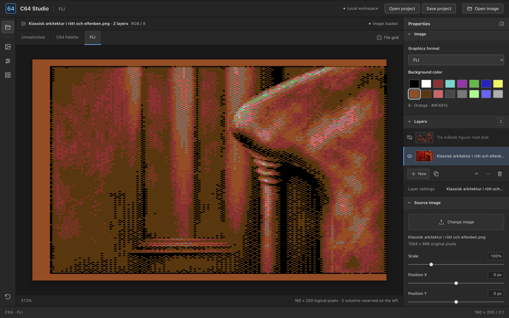
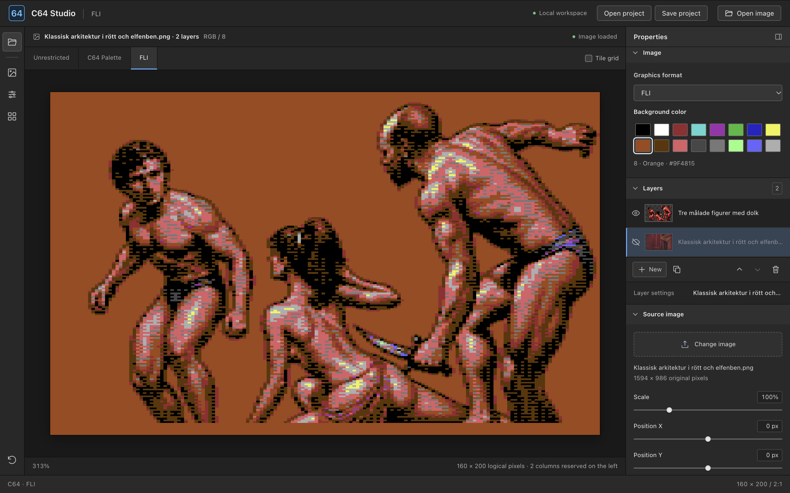

# C64 GFX Convert

[Open the converter](https://rogeralsing.github.io/c64gfxconvert/)

A browser-based Commodore 64 image converter with FLI, IFLI, MCI, AFLI, HIRES,
Multicolor Bitmap, Charset, standalone Sprites and NUFLI modes, optional virtual colors, sprite
overlays, and native exports. Image processing stays in your browser.



## Run locally

Open `index.html` in a modern browser. No build step or server is required.

Choose **Colodore (PAL)**, **Pepto (PAL)**, or **PEPTOette_a** in **Image → C64 palette**, below
the graphics format. Colodore remains the default. Switching updates conversion,
previews, color swatches, and virtual colors across all layers. Projects save
the chosen palette; older projects use Colodore. See [palette sources](palettes/README.md).

## Graphics formats

| Format | Logical pixels | Color allocation |
| --- | --- | --- |
| **FLI** | 160 × 200, double-width pixels | One shared background, one color per 4 × 8 tile, and two additional colors per scanline within each tile. |
| **IFLI** | Two 160 × 200 frames, double-width pixels | Alternates two FLI frames one hires pixel apart. Both frames share the background and tile color; scanline colors may differ. |
| **MCI** | Two 160 × 200 frames, double-width pixels | Alternates two standard multicolor frames one hires pixel apart. Both frames share the background and one tile color; each frame has two additional colors fixed throughout each 4 × 8 tile. The full image width is available. |
| **AFLI** | 320 × 200, square pixels | Two freely chosen colors per 8 × 1 scanline strip, with no shared background color. |
| **HIRES** | 320 × 200, square pixels | Two freely chosen colors per 8 × 8 tile, with no shared background color. |
| **HIRES · 2 colors** | 320 × 200, square pixels | One user-selected shadow/highlight pair for the entire image. Source brightness drives the pattern; no automatic palette matching. |
| **Multicolor Bitmap** | 160 × 200, double-width pixels | Three colors per 4 × 8 tile, plus one background color shared by the whole image. |
| **Charset · Hires + Multicolor** | 40 × 25 cells covering 320 × 200 pixels | Up to 256 unique patterns. Shared background and two shared multicolors; each cell chooses hires or multicolor with an individual foreground from colors 0–7. |
| **Multicolor Sprites** | 12 × 21 double-width pixels per sprite | One shared background, two shared multicolors, and one individual color per sprite. Configurable grid, up to eight sprites. |
| **Multicolor + Hires Sprites** | 24 × 21 display pixels per cell | A multicolor sprite beneath a hires sprite with its own color. Up to four cells, using eight hardware sprites. |
| **NUFLI** | 320 × 200, square pixels | A hires bitmap with 8 × 2 color cells and a sprite underlay for additional color choices. |

Virtual colors are a separate layer setting: **Off**, **Lines**, or **Checkers**.

**Image → Virtual color mode** selects the virtual palette for the whole image:
**Computed** keeps the existing generated color pairs, while **Talent** uses
76 common pairs observed in Talent's artwork, plus all 16 solid C64 colors.
Talent mixes those 92 entries in linear light using the selected C64 palette.
Choose **PEPTOette_a** to reproduce the sampled palette's RGB values. The mode
applies to every layer with virtual colors enabled and is saved in projects.
Older projects default to Computed. Each layer retains its own pattern,
brightness limits, and color exclusions. A mode switch keeps at least one
available color enabled within each layer's selected brightness range.

Select **Charset · Hires + Multicolor** to convert a full screen into one C64
character set. Choose a background and two shared multicolors from all 16 colors.
The converter scores each cell in hires and multicolor with every legal
foreground color. It compares rendered colors in Oklab, so close shades can
collapse to one foreground when that preserves more detail. Pattern reuse also
reconsiders the cell's foreground and resolution, rather than comparing glyph
bytes alone.

**Tile similarity** controls how much difference is allowed when merging nearby
patterns, even when the screen already fits within 256 glyphs. The default is
35%. At 0%, only identical patterns share a slot unless the hardware limit
forces approximation. Higher values allow more shape and shade differences.
Perceptual error limits protect contrast and dithering at moderate settings.
If the screen still needs more than 256 patterns, the converter retains
representative patterns by rendered similarity and refits the remaining cells.

The result includes both the charset and its 40 × 25 placement map. Merged cells
reference the same glyph index while retaining their own color and mode. The
preview always shows the actual exported result. The summary reports pattern
reduction, approximated cells, and how many cells use each mode; the generated
charset appears below.

In this mixed character mode, Color RAM bit 3 selects the cell's resolution:

| Color RAM | Cell mode | Foreground |
| --- | --- | --- |
| 0–7 | Hires, 8 × 8 pixels | The selected color 0–7 |
| 8–15 | Multicolor, 4 × 8 double-width pixels | The value AND 7, still color 0–7 |

For example, Color RAM value 9 means multicolor with a white foreground, not
brown. The background and both shared multicolors can still use colors 8–15.
This restriction applies to mixed multicolor character mode; pure hires text
mode can use all 16 foreground colors. All 256 glyphs are available in either
cell mode. Color RAM belongs to each screen position, not to a glyph definition.
See the [Commodore Programmer's Reference](https://www.commodore.ca/manuals/c64_programmers_reference/c64-programmers_reference_guide-03-programming_graphics.pdf), pages 115–117.

**Save charset** downloads a ZIP with a 2,048-byte `charset.bin`, 1,000-byte
`screen.bin`, 1,000-byte `color-ram.bin`, and a manifest containing shared colors
and VIC mode settings. It contains raw data without load addresses or a player.
Projects preserve shared colors, tile similarity, source layers, and conversion
settings. `screen.bin` places the glyphs in row-major order, and `color-ram.bin`
stores each position's foreground and hires/multicolor flag.
Source adjustments and per-layer dithering remain available; virtual colors and
line-end dithering do not apply to charset conversion.

For standalone sprites, choose **Multicolor Sprites** or **Multicolor + Hires
Sprites**. Set **Sprite grid · columns × rows** to a layout such as 1 × 1,
1 × 8, or 2 × 2. Every cell covers 24 × 21 display pixels. The overlay mode
uses two hardware sprites per cell, so 2 × 2 uses four multicolor sprites and
four hires overlays. Switching to overlays reduces an oversized grid to 2 × 2.

Choose the background and two shared multicolors, then use **Edit sprite colors**
to choose each cell's multicolor sprite color and optional hires overlay color.
The restricted preview fits only these colors. Source framing, adjustments,
layers, and per-layer dithering remain available. Virtual colors and line-end
dithering do not apply to standalone sprites. Overlay mode also shows the
multicolor and hires layers separately.

**Save sprites** downloads a ZIP containing `sprites.bin` and `manifest.json`.
The binary contains one native 64-byte frame per hardware sprite: 63 image
bytes and one zero padding byte. The manifest records colors, relative grid
positions, hardware slots, and VIC enable/multicolor masks. Hires overlays occupy
lower-numbered slots so they appear in front. The ZIP does not include a player.
Saved projects preserve the sprite grid and every chosen color.

For two-color artwork, select **Hires · 2 colors**, then choose **Shadow color**
and **Highlight color** from the normal C64 palette. Adjust **Brightness**,
**Contrast**, **Levels**, and **Dither** to shape the result. Dither at 0% uses a
hard threshold; 100% uses a 4 × 4 ordered pattern. Palette choices do not change
the pattern, so swapping the colors also works as an inversion. Transparent
layer edges use ordered coverage to keep the final image within the selected
pair. Both colors are preserved in saved projects.

**Save Hires** downloads an Art Studio `.art` image: 320 × 200 pixels with the
selected colors, stored as a native C64 hires bitmap. The 9,009-byte file contains
a `$2000` load address, bitmap, screen colors, border color, and padding. Export
always uses the converted image, even while viewing the unrestricted source.

**Save Multicolor** downloads a Koala Painter `.koa` image in **Multicolor Bitmap**
mode. The 10,003-byte file contains a `$6000` load address, bitmap, screen colors,
color RAM, and the selected background color. Export uses the fitted composition
from all visible layers, regardless of the selected preview tab.

**Save MCI** downloads a native True Paint `.mci` image containing both fitted
bitmaps, their separate screen colors, shared color RAM, and background color.
The 19,434-byte file loads at `$9C00`. Like other exports, it uses the fitted
composition regardless of the selected preview tab. MCI uses standard multicolor
cells without FLI's per-scanline color changes or reserved left columns.

The IFLI and MCI previews alternate the two frames and show them individually below
the simulation:



## Layers

Build one image from several source images, with separate conversion settings
for each layer. For example, put scenery on the bottom layer and figures with
a transparent background on a layer above it. Transparent pixels reveal the
layers below. The opening screenshot shows both layers combined; these views
show each layer on its own:

| Background layer only | Foreground layer only |
| --- | --- |
|  |  |

**Image** settings apply to the whole composition: graphics format, background
color where the format supports it, and hardware sprite colors in sprite
modes. All layers use the same graphics format.

Select a layer in **Layers** to edit its source image, position, scale,
brightness, contrast, levels, hue, saturation, noise, interlace, dithering,
virtual colors, palette limits, excluded colors, and sprite matching. Changes
apply only to the selected layer, so you can tune figures and scenery
independently.

- Click **New**, then **Choose image**, to add a source image to a new layer.
- Layers paint from bottom to top. Use the arrows to change their order.
- Click an eye to hide or show a layer without deleting it.
- Use **Duplicate** to start from an existing layer, or **Delete** to remove one.
- Double-click a selected layer name, or press **F2**, to rename it.
- Drag the preview to move the selected layer, or use **Scale**, **Position X**,
  and **Position Y** for precise placement.

Visible layers combine into one image before the final C64 tile restrictions
are applied. The preview and native export use that same fitted result.

## Projects

Use **Save project** to download a JSON file containing all layers, their source
images, and their settings. **Open project** restores that file, including layer
order, visibility, the active layer, shared graphics settings, and preview options.
Images are embedded in the JSON, so the original files are not needed to reopen
it. Larger source images produce larger project files. Projects stay local.

[Open the DutchBreezeRemake demo](https://rogeralsing.github.io/c64gfxconvert/?project=dutchbreeze)
with all layers and settings loaded. The `?project=dutchbreeze` query parameter
opens the bundled demo automatically. Without it, the converter starts empty.
You can also download [the project JSON](examples/DutchBreezeRemake.json) and
choose **Open project**.

## Tests

```sh
node --test tests/*.test.cjs
```

## GitHub Pages

GitHub Pages publishes the repository root from `main`. Pushes to `main`
automatically update the site. The `.nojekyll` file serves the static app
without Jekyll processing.
