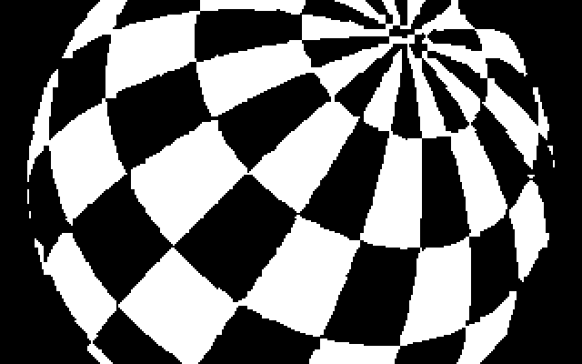
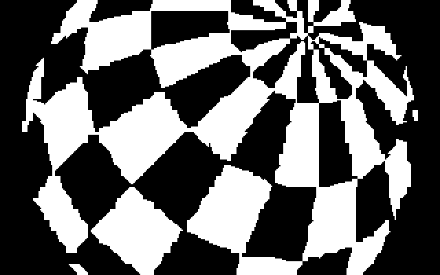

# Large sphere: storage versus native rendering speed

Measure the existing alternatives at 290-pixel diameter, 20 × 10 checker cells,
65° tilt and the selected 256-character font. The motion retains the camera-axis
rotation: 384 poses per turn, with 0.9375° steps.

See the [measured table](results/results.md), [complete JSON](results/results.json)
and [CSV](results/results.csv). The character players reach 50 or 25 FPS.
Compressed projected vertices store 217 poses in the current layout, but native
edge preparation and filling reduce that variant to 1.186 FPS. Compressed face
spans reach 4.583 FPS and store 28 poses.

The [lossy-delta follow-up](results/lossy.md) measures pixel-error thresholds,
preservation of empty/full cells, actual character-write counts and grouped-data
size estimates. Its selected protected 4-pixel case stores 63 poses at the same
verified 50/25 FPS playback rates.

Two image sources are measured separately. The analytic source preserves the
HTML preview's full-pixel character matching. Geometry uses 200 flat faces and
an eight-probe character lookup. The geometry delta cases use exactly the same
reference character screens as the geometry renderers.

| Analytic HTML image, actual VIC capture | Geometry image, actual VIC capture |
| --- | --- |
|  |  |

## Reproduce

Generate the analytic and geometric sources from the repository root:

```sh
rtk proxy node asm/sphere-polygons/font-v2/c64-preview/generate.cjs
rtk proxy node asm/sphere-polygons/font-v2/large-benchmark/geometry.cjs
rtk proxy node asm/sphere-polygons/font-v2/large-benchmark/edge-assets.cjs
rtk proxy node asm/sphere-polygons/font-v2/large-benchmark/edge-atlas-assets.cjs
```

Build and verify one geometry variant:

```sh
rtk proxy node asm/sphere-polygons/font-v2/large-benchmark/build-geometry.cjs --source=xy-delta --fill=fast
rtk proxy python3 asm/sphere-polygons/font-v2/large-benchmark/verify-geometry.py --variant=xy-delta-fast
```

Other measured combinations are `raw` with `individual` or `fast` filling, and
`packed`, `edges` or `edge-paths` with `fast` filling. Each build saves its own
PRG, symbols, source index and manifest under `build/native-geometry/variants/`.

The [character-delta study](delta-study.md) documents its build and verification
commands, including the separate image-identical geometry corpus. After every
case has a passing receipt, aggregate the frozen measurements:

```sh
rtk proxy node asm/sphere-polygons/font-v2/large-benchmark/report.cjs
```

## Measurement limits

PAL VICE runs at 100% speed, without warp, music or other interrupt workloads.
Forced display refresh on monitor break is disabled. Character deltas cover all
384 transitions using multiple RAM-sized native programs. Geometry covers
16 equally spaced poses, checking coverage bytes, final character codes,
immutable font and actual completed VIC scanout. Projected-vertex delta decoding
is included in its native timing.

The geometry verifier loads each pose's encoded source while emulation is
paused; it does not claim that the 217-pose geometry movie has been played
end-to-end. Capacity is the largest actual sequential encoded prefix that fits
the tested source area. Estimated duration is that count divided by measured
mean FPS. Stored-frame counts describe the current contiguous memory layout,
not an optimal packing of every free C64 address.

Character data occupies a 40,960-byte source area; geometry has 24,064 bytes
after its 12,612 bytes of glyph/mask/silhouette tables. Font, code, seed/state and
working buffers are separately listed in the JSON. The compressed-XY seed is
also mutable runtime state; those overlapping 728 bytes must not be added twice.

The direct packet decoder is rejected because an intermediate visible field
contains both old and new images. Its final-image cadence is not a valid
tear-free FPS result. The accepted direct sparse decoder passed every checked
visible field.
