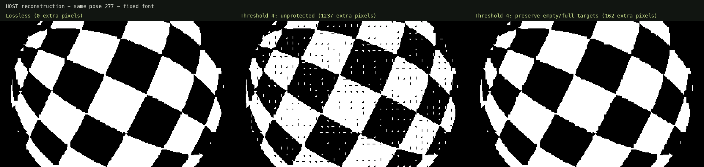

# Lossy character delta

Same 290-pixel sphere, 20 × 10 checks, 65° tilt and selected 256-glyph font. The font's smallest distinct-glyph difference is **3 pixels**, verified across all 32,640 pairs. A 2-pixel threshold therefore changes no data.

| Maximum ignored pixel difference per cell | Payload saved, full 384-pose cycle | Stored prefix frames | Mean extra wrong pixels per image | Native direct-front FPS |
| --- | ---: | ---: | ---: | ---: |
| 0 | 0.00% | 55 | 0.00 | not measured |
| 2 | 0.00% | 55 | 0.00 | 50.124 |
| 3 | 9.02% | 62 | 501.91 | 50.125 |
| 3, preserve empty/full targets | 6.43% | 60 | 83.50 | not measured |
| 4 | 13.96% | 66 | 931.40 | 50.124 |
| 4, preserve empty/full targets | 10.81% | 63 | 169.85 | 50.125 |
| 8 | 29.02% | 82 | 1648.88 | not measured |
| 8, preserve empty/full targets | 24.24% | 76 | 579.89 | not measured |

Error is additional difference against the existing lossless font image. Every decision compares the target with the glyph actually retained on screen; comparing only adjacent ideal frames would permit drift beyond the error budget. All cases pass 384-frame independent pixel checks and three complete sparse-decoder cycles. The cycle uses an exact closing patch to its original seed.

Unprotected thresholds can leave small holes or dots inside solid areas. Preserving target empty/full cells removes this artifact. Protected 4 stores 63 frames instead of 55, saves 10.81% of cyclic payload and adds 169.85 wrong pixels per image on average, 0.2654% of the screen. Native direct playback passed 50.125 FPS; hidden-plus-copy passed 25.062 FPS. Every tested empty/full target cell stays exact.

## Actual writes per image

Without loss: mean 25.6875 empty writes, 24.015625 filled writes and 325.328125 partial-glyph writes, over 384 cyclic transitions. The initial 1,000-character seed is excluded. Empty/full writes are 13.253% of 375.03125 total writes. The screen contains 397.31 empty, 234.79 filled and 367.89 partial cells on average; most unchanged cells need no write.

## Grouping repeated glyphs

The current sparse format repeats (offset8,glyph8) per update inside four 256-byte blocks. A grouped record (glyph8,count8,offset8[]) reduces six repeats from 12 to 8 bytes. Grouping every glyph makes this particular lossless corpus 17.70% larger because many groups contain only one glyph. A hybrid that groups occurrences of three or more and retains individual pairs for the rest stores 6.36% smaller payload. Combining it with protected 4 uses 241,658 bytes versus 289,560 lossless bytes across the full cycle.

The four-block hybrid native player stores 59 lossless poses (40,396 bytes) or 68 protected-4 poses (40,870 bytes). It passed actual completed-field VIC checks at 50.125 FPS for every stored pose. Block order is preserved while groups reorder writes within each block. These two prefixes showed no tearing. Pure all-grouped data stores only 46 lossless poses; its native decoder is not timed.

```text
Per block: groupCount8, singleCount8
Groups: glyph8, count8, offset8[count]
Individual updates: offset8, glyph8
```

Host-generated 6502 routines also pass execution checks, but cost more memory: 21 lossless poses in screen order or 28 grouped by glyph. No native FPS is claimed for those generated routines.

## Reproduce

```sh
rtk proxy node asm/sphere-polygons/font-v2/large-benchmark/lossy-study.cjs
rtk proxy node asm/sphere-polygons/font-v2/large-benchmark/lossy-study.cjs --protect-solids
rtk proxy node asm/sphere-polygons/font-v2/large-benchmark/lossy-native.cjs --threshold=4 --protect-solids
rtk proxy python3 asm/sphere-polygons/font-v2/large-benchmark/verify-lossy.py --threshold=4 --protect-solids
rtk proxy node asm/sphere-polygons/font-v2/large-benchmark/lossy-report.cjs
```

[Full results and measurement scopes](lossy.json)


